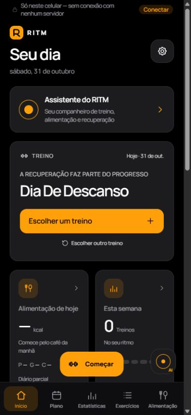

# Visual escuro — primeira etapa

Pedido: aproximar o RITM do visual limpo do openGym, com preto e cinza escuro e a cor de destaque realmente aplicada. Laranja é uma escolha nas configurações, não uma preferência imposta nem uma decoração sazonal.

## Causa encontrada

O sistema original de cores já aplicava `data-accent` corretamente. A camada visual da edição pessoal substituía esse valor por verde fixo nos cartões de treino, plano e estatísticas. O botão flutuante “Começar” também tinha verde fixo. O fundo adicionava cores azuladas, texturas e gradientes.

## Mudanças

- Recuperada a paleta neutra já existente: fundo preto, cartões em cinza escuro. O modo claro e a opção de acompanhar o sistema continuam disponíveis.
- Retiradas as texturas e os gradientes decorativos do fundo e do cartão de treino. Menos sombras, títulos menos pesados e cantos mais discretos.
- Cartão de treino inicial mais compacto, sem a ilustração de círculos. Todos os botões e dados foram mantidos.
- Botão principal, botão “Começar”, marca e detalhes do início seguem a cor escolhida. Os cartões compartilhados de plano e estatísticas também deixam de fixar o verde; essas telas não foram reorganizadas.
- Indicador do assistente simplificado e sem animação decorativa. Seu acesso permanece no mesmo lugar.
- Ajustada a cor do texto dos botões preenchidos para preto: contraste mínimo medido de 5,08:1 entre as oito opções, nos dois temas. Avisos, erros, descanso em andamento e demais cores de estado conservam sua função.
- A cor da barra do navegador acompanha a nova base. A versão de teste continua com `local.opengym.personal.test`, nome “RITM Teste BR” e sufixo de versão `.dark-test.2`.

## Verificações em 31 de outubro de 2026

- Compilação Vite concluída. Compilação Android de teste concluída; 16 testes unitários nativos aprovados (sem mudanças na lógica nativa).
- 17 testes existentes aprovados: `Home.startdoor`, `Home.weight-card` e `useStore.config`.
- Navegador: oito cores selecionadas pelas configurações; o botão do cartão inicial e “Começar” acompanharam as oito no modo escuro. As oito cores de “Começar” também foram conferidas no modo claro.
- Contraste calculado para texto preto: de 5,08:1 a 14,88:1 nas dezesseis combinações de tema/cor. Essa medida se refere aos botões preenchidos, não a uma auditoria completa de acessibilidade de todas as telas.
- Prévia em tamanho de celular, com largura útil de 378 pixels: sem rolagem horizontal na página inicial. Fundo `rgb(0,0,0)`, cartão `rgb(28,28,30)` e botão laranja `rgb(255,159,10)`.
- Não houve alterações em funções de cálculo, banco de dados, importação, exportação ou migração. A bateria completa anterior não foi repetida para esta mudança visual.

## Conferência no aparelho

Instalar a nova cópia de teste e escolher Configurações → Aparência → Escuro e Laranja (ou outra cor). Ela pode atualizar a cópia “RITM Teste BR” anterior, com a mesma assinatura, sem substituir o RITM original. Não desinstale o original. Faça backup antes de qualquer importação. Instalação física, dados reais e aparência das barras nativas ainda precisam de conferência no aparelho.

Esta primeira etapa não redesenha formulários de alimentação, exercícios ou navegação. Telas internas ainda podem ter estilos próprios; elas ficam para revisões pequenas depois da avaliação do início. Os alertas herdados de dependências continuam documentados em [fabio-ptbr.md](fabio-ptbr.md).

## Prévia

